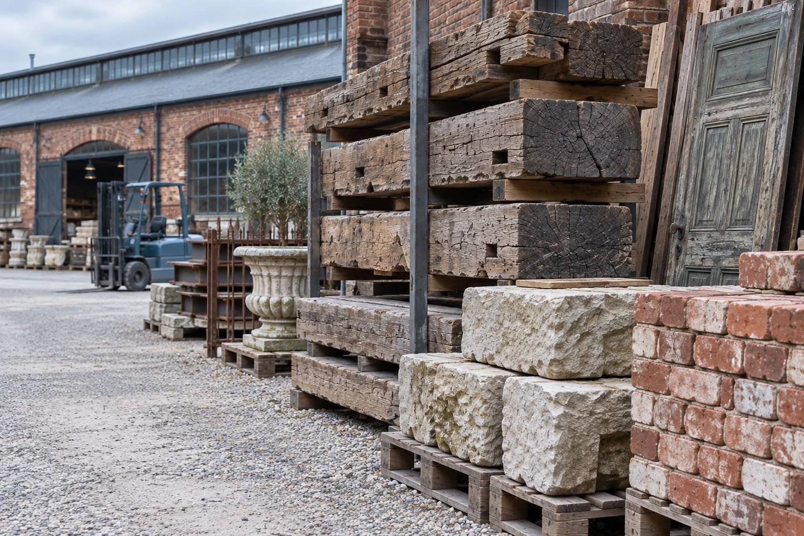
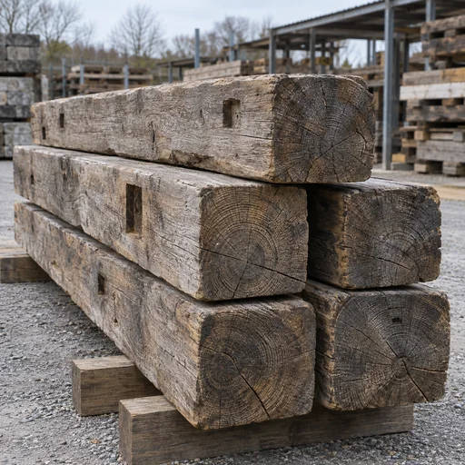
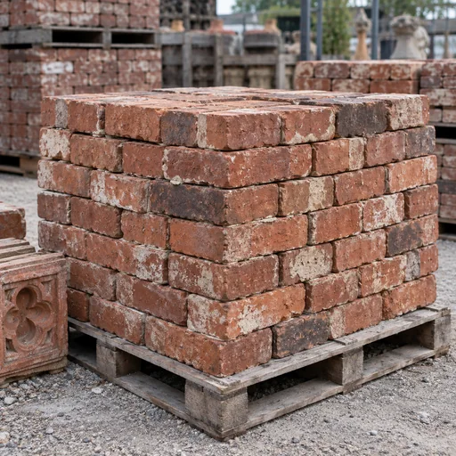
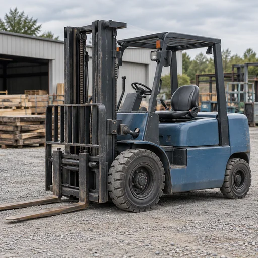
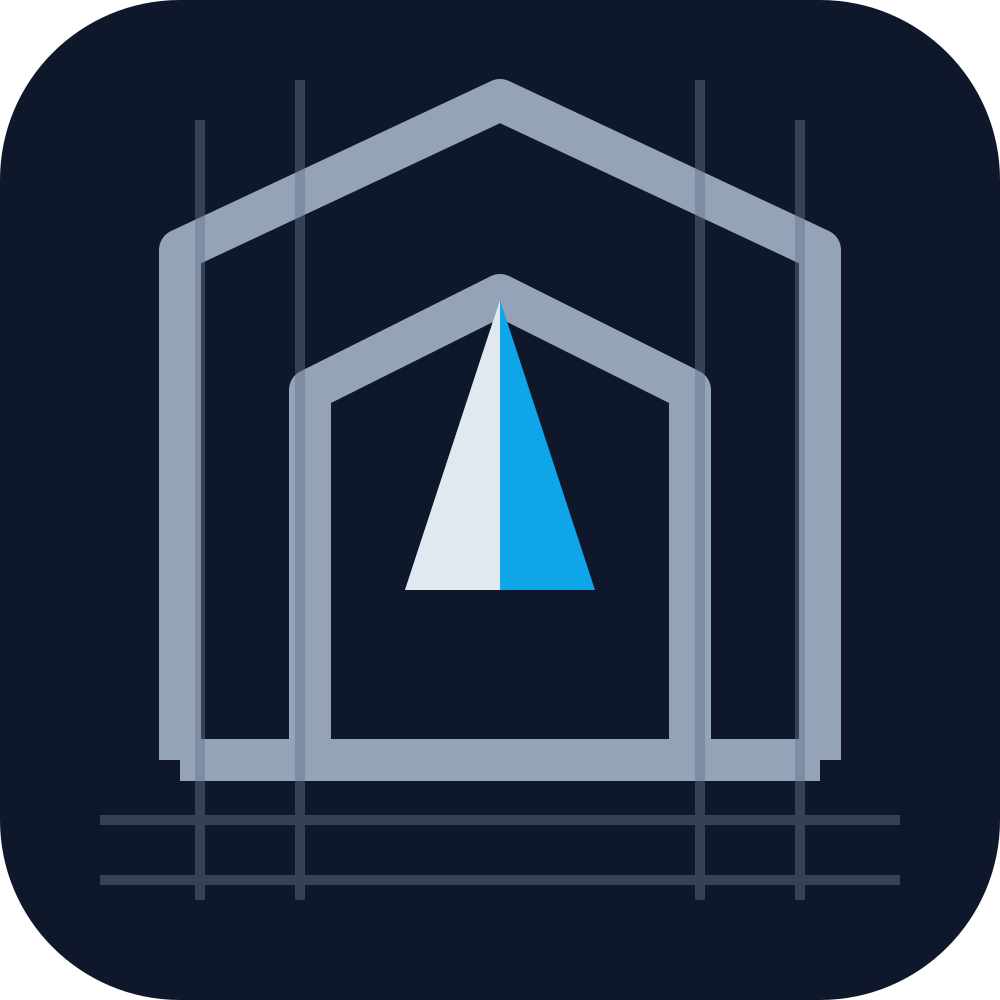

<picture>
  <source media="(prefers-color-scheme: dark)" srcset="assets/salvage-atlas-wordmark-dark-bg.png" />
  <source media="(prefers-color-scheme: light)" srcset="assets/salvage-atlas-wordmark-light-bg.png" />
  
</picture>

### A global operating system for the recovery and reuse of valuable materials

**RECOVER &nbsp;·&nbsp; DOCUMENT &nbsp;·&nbsp; CONNECT &nbsp;·&nbsp; TRADE &nbsp;·&nbsp; REUSE**

 

 

> **The building may be gone. The materials don't have to be.**

---

## A second life for the world's useful materials

**Salvage Atlas** is an independently developed commercial marketplace and operating platform for reclaiming, documenting, and moving building materials, architectural salvage, industrial equipment, and other reusable physical assets.

Valuable resources are lost when buildings come down, factories close, and recoverable materials are discarded because the people who have them and the people who need them cannot connect efficiently.

**We're building a worldwide network that makes recovery, reuse, and trade more practical for real businesses.**

  
  &nbsp;
  
  &nbsp;
  

## One connected recovery economy

| Platform area | What it helps people do |
|:--|:--|
| **Exchange** | Find and offer reclaimed materials, reusable equipment, and salvage inventory |
| **Atlas** | Discover material opportunities, recovery projects, crews, and services by region |
| **Crews & Services** | Connect property owners, recovery contractors, inspectors, processors, and specialists |
| **Material Passports** | Preserve material identity, origin, and documented history over time |
| **Business Operations** | Coordinate offers, agreements, logistics, inspection, and transaction records |
| **Trends** | Understand the reclaimed-materials market through industry information and intelligence |

*Individual capabilities are at different stages of development. This overview describes the platform's direction, not a declaration that every feature is available today.*

## Built for the people doing the work

From farmers and property owners to deconstruction crews, salvage yards, builders, architects, manufacturers, equipment dealers, processors, and logistics professionals.

We believe useful materials deserve a discoverable market, an understandable history, and another productive life.

## A practical technology approach

Salvage Atlas is designed to work like ordinary business software. **No cryptocurrency wallet, token purchase, or blockchain knowledge is required for customers.**

We're also **exploring integration with the Vitruveo blockchain** as a behind-the-scenes integrity and attestation layer for selected material provenance, transaction milestones, evidence records, and digital business achievements. These are future-facing design areas, **not live blockchain features or a declared investment partnership**.

The business remains independent. Its application, data, marketplace search, privacy controls, and conventional payment arrangements are not dependent on a blockchain.

## See the project

### [Explore the development preview](https://deploy-preview-486--chic-bombolone-c40872.netlify.app/)

**DEVELOPMENT PREVIEW — NOT A PUBLIC LAUNCH**

The preview may be incomplete, access-restricted, or unavailable. **Please do not register, upload personal information or documents, create listings, or attempt transactions.** The link is provided only to show the application's appearance and direction.

## About this GitHub repository

This **public presentation repository** explains Salvage Atlas to visitors, potential collaborators, and industry participants. It does **not** contain the application source code, operational infrastructure, customer information, deployment configurations, private issues, or the internal development roadmap.

The underlying application and infrastructure repositories remain private. This repository does not grant an open-source license for the platform or permission to reuse the logo or visual assets.

---

**Real materials. Real commerce. Better recovery.**

*Salvage Atlas LLC · © 2026 · All rights reserved.*

